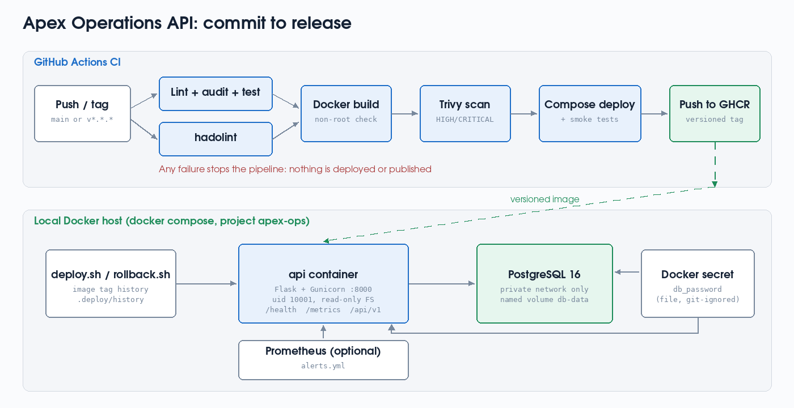
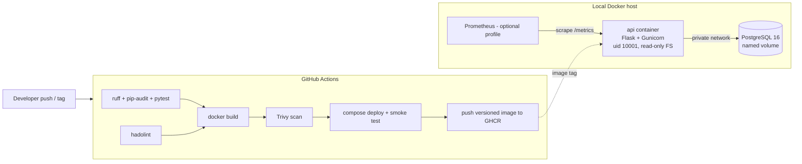

# Apex Operations API: commit-to-release demo

A small task-tracking API ("Apex Operations API") packaged in Docker, tested and scanned in CI,
deployed locally with Docker Compose, and released with versioned images plus automatic and manual rollback.

> Candidate: Hammad Kamran Faruki · Junior DevOps Engineer assessment, Apex AI Arabia
> AI assistance was used and is disclosed in [docs/AI_DISCLOSURE.md](docs/AI_DISCLOSURE.md).

## What is included

| Requirement | Where |
|---|---|
| Minimal API with health/readiness, non-root container | `app/`, `Dockerfile` |
| CI: install, lint, test, build, block on failure | `.github/workflows/ci.yml` |
| Compose deployment: app + PostgreSQL, env config, persistent volume | `docker-compose.yml` |
| Versioned release and rollback (automatic + manual) | `scripts/deploy.sh`, `scripts/rollback.sh`, `scripts/release_demo.sh` |
| Structured logs, health checks, metrics, alert proposal, failure investigation | `app/logging_setup.py`, `/metrics`, `monitoring/`, `scripts/failure_drill.sh`, `docs/FAILURE_INVESTIGATION.md` |
| Secrets, least privilege, scanning, cloud cost path | `docs/DECISIONS.md` |
| Runbook | `docs/RUNBOOK.md` |
| Evidence | `evidence/` (see `docs/EVIDENCE.md`) |

## Architecture





## Endpoints

| Method | Path | Purpose |
|---|---|---|
| GET | `/health/live` | Liveness: process is up (no dependency checks) |
| GET | `/health/ready` | Readiness: database reachable, else 503 |
| GET | `/metrics` | Prometheus metrics |
| GET | `/api/v1/version` | Running release version |
| GET / POST | `/api/v1/tasks` | List / create tasks (`{"title": "..."}`) |
| GET / PATCH | `/api/v1/tasks/<id>` | Read / update status (`open`, `in_progress`, `done`) |

## Prerequisites

- Docker Engine 24+ with the Compose v2 plugin (Docker Desktop is fine)
- `bash`, `curl`, `openssl`, `python3` (on Windows, run everything inside **WSL2 Ubuntu** with Docker Desktop's WSL integration enabled)
- Python 3.12 only if you want to run the tests outside Docker

## Quick start (exact steps)

```bash
git clone <repo-url> apex-ops-api && cd apex-ops-api
chmod +x scripts/*.sh

# 1. Deploy version 1.0.0 (generates a local DB password, builds, starts, smoke-tests)
./scripts/deploy.sh 1.0.0

# 2. Try it
curl -s http://127.0.0.1:8000/health/ready
curl -s -X POST http://127.0.0.1:8000/api/v1/tasks -H 'Content-Type: application/json' -d '{"title":"Check backups"}'
curl -s http://127.0.0.1:8000/api/v1/tasks
curl -s http://127.0.0.1:8000/metrics | head -20
docker compose logs -f api        # structured JSON logs
```

## Run the tests locally

```bash
python3 -m venv .venv && source .venv/bin/activate
pip install -r requirements.txt -r requirements-dev.txt
ruff check .
pytest -v
DEMO_FAIL=1 pytest -v            # shows the intentional failure
```

## Release and rollback demo

```bash
./scripts/release_demo.sh         # 1.0.0 -> 1.1.0 -> broken 1.2.0 (auto rollback) -> manual rollback; log in evidence/
./scripts/rollback.sh             # roll back to the previous good release
./scripts/rollback.sh 1.0.0       # roll back to a specific version
```

## Failure investigation drill

```bash
./scripts/failure_drill.sh        # stops PostgreSQL, shows detection/diagnosis, recovers; log in evidence/
```

## Optional monitoring

```bash
docker compose --profile monitoring up -d prometheus
# open http://127.0.0.1:9090 -> Alerts
```

## Clean up

```bash
docker compose --profile monitoring down -v   # -v also deletes the database volume
```

## Assumptions

- "Local environment" means a single Docker host; no paid cloud resources were used.
- A task-tracking API is a reasonable stand-in for "Apex Operations API".
- GitHub Actions is the CI system; GHCR is the image registry (free for this use).
- Synthetic data only.

See [docs/DECISIONS.md](docs/DECISIONS.md) for trade-offs and what I would improve with more time.
